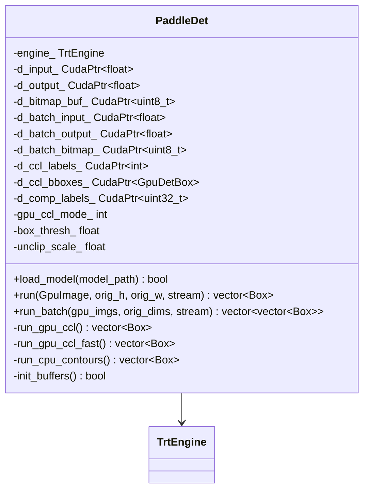
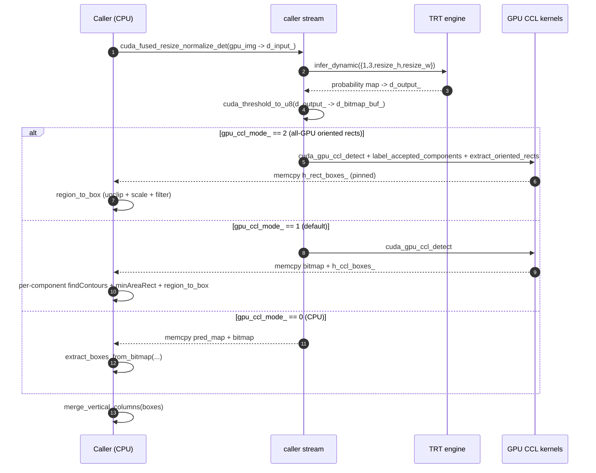

# Detection — `PaddleDet`

The first stage of every OCR call. Locates text-bearing pixels and emits
quadrilateral boxes for the downstream recognizer. Everything else in the
pipeline runs only on what `PaddleDet` decides is text — false negatives here
are unrecoverable, so the detector runs at full input resolution capped only by
`DET_MAX_SIDE_LIMIT` (default 1280 px; the TensorRT profile must match). It is the only stage
that scales preprocessing to the source image; classification, layout, and
recognition all use fixed input shapes.

## Why this design

DB (Differentiable Binarization) is a per-pixel probability map → bitmap →
contour pipeline. The CPU contour path is portable but spends ~3 ms downloading
the probability map and another ~2 ms in `findContours`. To stay inside the
text-only latency invariant, three contour modes are wired and selectable at
runtime via the `GPU_CCL` env var:

| `GPU_CCL` | Path | Notes |
| --- | --- | --- |
| `0` | CPU contours fallback | Downloads pred_map + bitmap; `cv::findContours`. Reference accuracy. |
| `1` | **GPU CCL + per-ROI findContours** *(default)* | GPU connected-component labelling, then `findContours` on tiny per-component ROIs. Rotated min-area-rect quads. Filled-contour means computed on GPU, using the same rasterization as mode 0. |
| `2` | All-GPU oriented rects | Each accepted component's rotated rectangle from one PCA reduction on the GPU. No pred_map download, no `findContours`. |

Mode 1 scores **all pixels inside its selected filled contour**, including
low-probability interior pixels. Previously it averaged only thresholded
foreground pixels, which could promote hollow graphics to text candidates.
The foreground-score prefilter is disabled for this mode; `DET_BOX_THRESH`
(or its `GPU_BOX_THRESH` override) is applied to the filled-contour score.

Mode 1 still extracts its contours on the CPU. Only the derived bitmap comes
down; filled masks and ROI descriptors are batched back to the GPU, where the
probability map stays resident. A preallocated staging area holds at most one
maximum-size map of mask bytes plus 256 descriptors and scores. Overlapping
masks flush bounded batches. The scorer adds about one max-map byte per pixel
on device and one in pinned host memory; it never downloads source pixels or
the probability map. Added copies, reductions and synchronizations need GPU
latency measurement before promotion.

This aligns the **score definition**, not the candidate populations: mode 0
visits all contours, mode 1 selects the largest contour per component ROI, and
mode 2 retains foreground scoring and PCA geometry. No detector score proves
that an unreadable crop is harmless; caller-side mandatory coverage still applies.

Every mode ends in the same unclip (`detection::region_to_box`), PaddleOCR's
for quadrilateral boxes: the region's min-area rectangle grown by
`area × unclip_ratio / perimeter` on every side. Offsetting a rectangle with
round joins leaves its min-area rectangle exactly that grown rectangle, so the
offset polygon is never built. Growing the region's pixel outline instead gives
smaller boxes — a jagged outline has less area and more perimeter than its
rectangle — and those clip the narrow last glyph of a line (`、`, `。`, `,`).

The mode docstring is in
[`include/turbo_ocr/detection/paddle_det.h:46-54`](https://github.com/aiptimizer/TurboOCR/blob/main/include/turbo_ocr/detection/paddle_det.h);
the three implementations live in
[`src/detection/paddle_det.cpp:103-321`](https://github.com/aiptimizer/TurboOCR/blob/main/src/detection/paddle_det.cpp).

### Controlled comparison

Build `turbo_ocr_tests`, `turboocr-device` and `diff_ccl` in a GPU build. Run:

```sh
./build/turbo_ocr_tests '[det_gpu][contour_score]'
DIFF_DET_ENGINE=/absolute/path/to/det.engine \
DIFF_REFERENCE_MODE=0 DIFF_CANDIDATE_MODE=1 \
DET_BOX_THRESH=0.75 DET_MAX_SIDE=1280 DET_MAX_SIDE_LIMIT=1280 \
DIFF_CROPS=0 ./build/diff_ccl /absolute/path/to/synthetic-desktop.png
```

Use a matching engine profile, fixed source image/ROI, identical model and
threshold settings, and no inherited `GPU_BOX_THRESH` override. Explicit engine
selection avoids building a different model for the comparison. The comparator
reports geometry/counts, not recognized text, and the command disables crops.
Its legacy output labels CPU/GPU refer to the reference/candidate respectively;
the selected mode numbers are printed first. Defaults remain modes 1 versus 2.

Counts/IoU alone are not a privacy acceptance test. Also run the full redaction
replays with known tiny/low-contrast identifiers and typing/drag/scroll cases,
measure exposed sensitive pixels, source preservation, false mask area and
latency. Retries and full-screen scheduling are separate experiments. Fewer
boxes alone is not a reason to deploy.

## Model card

| Field | Value |
| --- | --- |
| ONNX path | `models/det.onnx` |
| Engine cache key | `det_<gpu>_<trt_version>.plan` (built by `engine::TrtEngine`) |
| Input tensor | `x : (N, 3, H, W)` float32, BGR, ImageNet-normalised |
| Dynamic profile | MIN `(1,3,32,32)` · OPT `(DET_OPT_BATCH,3,min(640,M),min(640,M))` · MAX `(8,3,M,M)`, where `M` is the effective detector max side (default 1280). Existing externally supplied engines must have a matching profile. |
| Output tensor | `(N, 1, H, W)` float32 probability map |
| Precision | FP16 |
| Batch | up to `kMaxBatchSize = 8` ([`paddle_det.h:61`](https://github.com/aiptimizer/TurboOCR/blob/main/include/turbo_ocr/detection/paddle_det.h)); per-batch H/W unified to the max, rounded to 32 |
| DB thresholds | Each model's own config: `thresh 0.2`, `box_thresh 0.40` (tiny) / `0.45` (small, medium), `unclip_ratio 1.4` ([`det_config.h`](https://github.com/aiptimizer/TurboOCR/blob/main/include/turbo_ocr/detection/det_config.h)); `DET_DB_THRESH` / `DET_BOX_THRESH` / `DET_UNCLIP` override |
| Min box side | `kMinBoxSide = 3 px`, `kMinUnclippedSide = 5 px` |

The unified-batch-shape trick (`paddle_det.cpp:413-416`) lets `run_batch` use a
single TRT execute even when sources differ in size: every image rounds up to
`(max_h, max_w)` quantised to multiples of 32.

## Latency budget

On RTX 5090 / TRT 10.15.1 / CUDA 13 the **whole pipeline** text-only aggregate
p50 is **5.9–7.0 ms** across sweeps 1–8 of internal engineering notes.
Detection dominates that figure on dense pages; cls / rec / layout overlap
onto secondary streams. The 270 ms text-only target named in the brief is
**~38× looser** than measured, so `PaddleDet` retains headroom even when
`DET_MAX_SIDE` is pushed to 2400 for very dense scans.

## C++ surface



`CudaPtr<T>` / `CudaHostPtr<T>` are RAII handles for `cudaMalloc` and
`cudaMallocHost` allocations — `~PaddleDet()` is `= default`
([`paddle_det.h:22`](https://github.com/aiptimizer/TurboOCR/blob/main/include/turbo_ocr/detection/paddle_det.h)) because
every device buffer cleans itself up.

## Per-image flow



`run(...)` is at
[`paddle_det.cpp:323-366`](https://github.com/aiptimizer/TurboOCR/blob/main/src/detection/paddle_det.cpp) and ends with a
CJK-trad vertical-column merge pass that fuses fragmented vertical text columns
before the boxes leave the stage.

## Where it plugs in

Called from `OcrPipeline::run_with_layout` immediately after `upload_image`
([`ocr_pipeline.cpp:626`](https://github.com/aiptimizer/TurboOCR/blob/main/src/pipeline/ocr_pipeline.cpp)). The caller's
CUDA stream owns the upload and the detection. Everything downstream
(`PaddleCls`, `PaddleLayout`, `PaddleRec`) runs on a separate stream and waits
on `det_event_` / `det_only_event_` — see
[Architecture · CUDA Streams](../architecture/cuda-streams.md).

!!! info "See also"
    - [Classification](classification.md) — vertical-box rotation that runs on detection output.
    - [Recognition](recognition.md) — what the boxes actually feed into.
    - [CUDA Streams](../architecture/cuda-streams.md) — `det_event_` / `det_only_event_` records, and the gates downstream stages wait on.
    - [Pipeline](../architecture/pipeline.md) — where detection sits in `run_with_layout`.
